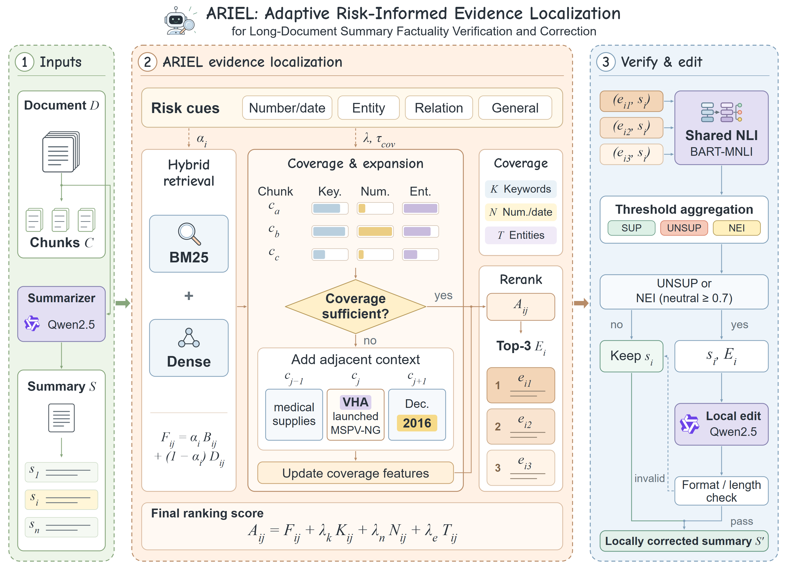

# ARIEL

ARIEL 面向长文档摘要的事实性验证与局部纠错。仓库提供基于 GovReport 的 Python 实现，从源文档中检索摘要句的支持证据，使用 NLI 判断事实一致性，并通过局部改写修正风险句。

## 方法概览

[](docs/architecture.png)

**摘要生成与切分。** 使用 Qwen2.5 生成摘要，较长文档先分段生成中间摘要，再合并。将摘要拆成句子作为检索查询，将源文档按段落和长度限制切成证据块。

**证据定位。** BM25 与 Dense 分别从源文档召回候选块，归一化分数后融合。ARIEL 按摘要句的风险类型调整权重：数字、日期和实体类偏向 BM25，关系类偏向 Dense。融合分数再加入关键词、数字日期与实体的覆盖得分；覆盖不足时扩展相邻上下文，更新得分并重排序，保留 Top-3 证据。

**句子级验证。** BART-MNLI 逐对判断证据与摘要句之间的蕴含、矛盾或中立关系，并按阈值聚合为 **Supported**、**Unsupported** 或 **Not Enough Information**，保留各条证据的预测分数与判定依据。

**局部纠错与再评估。** Qwen2.5 根据证据改写 Unsupported 句及中立置信度达到纠错阈值的 Not Enough Information 句，尽量保留原句措辞与结构。改写结果与其余句子按原顺序组成新摘要，再次检索和验证，比较纠错前后的事实性指标、ROUGE 与摘要长度。

## 快速开始

以下以 **5 篇 GovReport 文档**为例，依次完成摘要生成、事实性验证、局部纠错和评估。所有命令均在仓库根目录执行。

### 1. 安装

环境要求：Linux / WSL、Python 3.10+、Bash 和支持 CUDA 的 NVIDIA GPU。

```bash
git clone https://github.com/WalnuTpz/ariel-long-summary-factuality.git
cd ariel-long-summary-factuality

python3 -m venv .venv
source .venv/bin/activate
python -m pip install -r requirements.txt
```

首次运行时会从 HuggingFace 下载以下模型：

| 模块 | 模型 |
|---|---|
| 摘要生成与局部纠错 | `Qwen/Qwen2.5-1.5B-Instruct` |
| Dense 检索 | `sentence-transformers/all-MiniLM-L6-v2` |
| NLI 验证 | `facebook/bart-large-mnli` |

### 2. 准备数据

下载 validation split 中前 5 篇有效文档，并转换为统一的 JSONL 格式：

```bash
python scripts/download_govreport_sample.py \
  --split validation \
  --limit 5 \
  --output data/raw/govreport_quickstart_5.jsonl

python -m src.load_data \
  --input data/raw/govreport_quickstart_5.jsonl \
  --output data/processed/documents_quickstart_5.jsonl \
  --min-document-chars 2000
```

输入包含源文档及参考摘要，字段说明见 [data/README.md](data/README.md)。

### 3. 生成摘要并运行 ARIEL

运行完整流水线，生成摘要后进行证据定位、验证、局部纠错和再次评估：

```bash
CONFIG= PYTHON=.venv/bin/python \
  DOCUMENTS=data/processed/documents_quickstart_5.jsonl \
  RUN_DIR=data/results/quickstart_5 \
  RETRIEVAL_METHOD=ariel SUMMARY_FIELD=generated_summary \
  RUN_SUMMARIZE=1 RUN_CORRECTION=1 RUN_AFTER_VERIFY=1 RUN_CASE_EXPORT=1 \
  SUMMARY_DEVICE=cuda EMBEDDING_DEVICE=cuda NLI_DEVICE=cuda \
  bash scripts/run_pipeline.sh
```

`RUN_SUMMARIZE=1` 启用摘要生成；`CONFIG=` 使脚本直接使用本条命令的设置。生成的摘要和后续结果都写入 `data/results/quickstart_5/`，重复运行时会复用已有摘要。

### 4. 查看结果

| 文件 | 内容 |
|---|---|
| `generated_summaries.jsonl` | Qwen2.5 生成的原始摘要 |
| `corrections.ariel.jsonl` | 纠错后的摘要与逐句编辑记录 |
| `evaluation.ariel.summary.json` | 纠错前后汇总指标 |
| `cases.ariel.md` | 代表性案例及其证据 |

查看汇总指标：

```bash
python -m json.tool data/results/quickstart_5/evaluation.ariel.summary.json
```

案例可直接打开 `data/results/quickstart_5/cases.ariel.md` 阅读，句子级验证结果分别保存在 `verification.before.ariel.jsonl` 和 `verification.after.ariel.jsonl`。

## 评测指标

| 指标 | 含义 |
|---|---|
| ROUGE-1/2/L | 生成摘要与参考摘要的 unigram、bigram 和最长公共子序列重叠 F1 分数。 |
| Supported Ratio | NLI 判为 Supported 的摘要句比例。 |
| Risk Ratio | NLI 判为 Unsupported 或 Not Enough Information 的摘要句比例。 |
| 平均风险句数 | 每篇摘要中 Unsupported 与 Not Enough Information 句子的平均数量。 |
| Length Ratio | 纠错后摘要词数与纠错前词数之比。 |

Supported Ratio 和 Risk Ratio 先在每篇摘要内计算，再对摘要取平均。评估实现见 [evaluate_summary.py](src/evaluate_summary.py)。

## 实验复现

主实验使用 **600 篇文档及固定生成摘要**。先完成[主实验数据准备](docs/reproduction.md#2-准备主实验文档)和[摘要生成](docs/reproduction.md#3-生成并固定主实验摘要)，再运行：

```bash
# 四种检索方法与三组 ARIEL 消融
CONFIG=configs/main_600_compare_gpu.env bash scripts/run_compare_retrieval.sh

# ARIEL 局部纠错与纠错后评估
CONFIG=configs/main_600_pipeline_gpu.env bash scripts/run_pipeline.sh

# 汇总主结果、长度分桶、消融和纠错对比表
CONFIG=configs/main_600_tables_gpu.env bash scripts/make_tables.sh
```

表格合集位于 `outputs/tables/main_600_gpu/paper_tables.md`。

受控长度实验取同一组 100 篇文档，分别生成目标长度为 80、240、520 词的摘要：

```bash
CONFIG=configs/controlled_length_100_gpu.env \
  bash scripts/run_controlled_length_experiment.sh
```

结果位于 `outputs/tables/controlled_length_100_wide_gpu/controlled_length.md`。参数、输出文件与论文实验的对应关系见[复现指南](docs/reproduction.md)。

## 仓库结构

```text
ariel-long-summary-factuality/
├── README.md
├── requirements.txt  # Python 依赖
├── src/              # 摘要生成、证据检索、验证、纠错与评估
├── scripts/          # 数据准备、实验运行与结果汇总
├── configs/          # 小样本检查与主实验配置
├── data/             # 数据格式说明与本地实验数据
└── docs/             # 架构图、复现指南与课程任务说明
```

## 参考与致谢

感谢南京大学自然语言处理课程仓库 [NJU_NLP_Project_2026](https://github.com/zifengcheng/NJU_NLP_Project_2026/) 提供的项目基础，原始任务说明见 [课程作业要求](docs/长文摘要事实一致性评测与纠错.md)。

感谢 [GovReport](https://huggingface.co/datasets/ccdv/govreport-summarization)、[Qwen2.5](https://huggingface.co/Qwen/Qwen2.5-1.5B-Instruct)、[Sentence Transformers](https://www.sbert.net/) 和 [BART-MNLI](https://huggingface.co/facebook/bart-large-mnli) 的作者提供数据、模型与工具。
